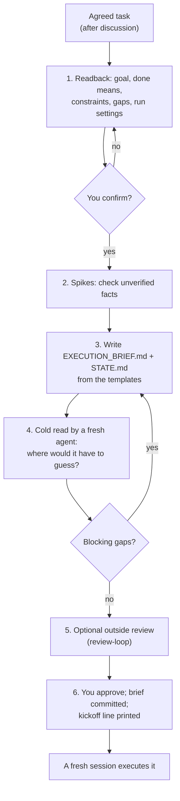

# execution-brief

After you and the agent have agreed on a task, it packs everything into two files that a fresh agent can execute from scratch with no access to this conversation: the goal and why, the limits, verified facts, work cards with acceptance commands, and a state file for progress.

| | |
|---|---|
| **Input** | A task you and the agent have aligned on. |
| **Output** | `docs/blueprints/<date>-<slug>/EXECUTION_BRIEF.md` and `STATE.md`, committed on a branch, plus one kickoff line to paste into a new session. |
| **Your files** | Only the brief's folder is written; the work itself happens later, in the fresh session. |

- The fresh session that executes the brief is also the real test that the brief stands on its own.
- **Status:** experimental (2026-10-18); smoke test only.
