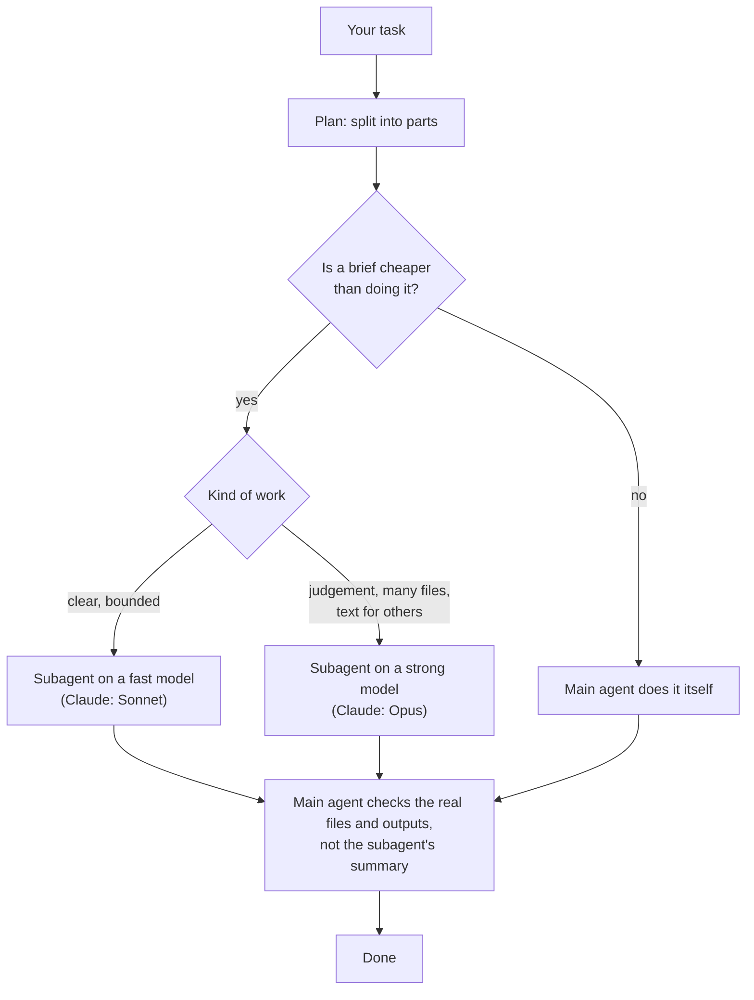

# orchestrate

The main agent acts as a manager: it plans the task, hands the parts worth handing off to subagents (a fast model for clear, bounded work, a strong one for judgement), runs independent parts in parallel, and checks the real results itself before calling anything done.

| | |
|---|---|
| **Input** | A multi-step task, `/orchestrate`, or "use subagents". |
| **Output** | The finished task; subagents report back to the main agent only. |
| **Your files** | Changed as the task requires; every change verified by the main agent. |

- Each subagent brief carries the goal, file paths, constraints, what "done" means and what to hand back, because subagents do not see the conversation.
- **Status:** active (2026-10-07).
