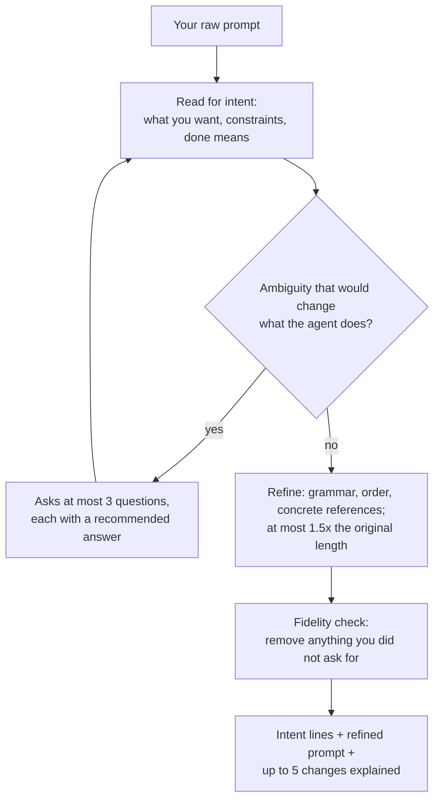

# refine-prompt

Takes your rough prompt and returns a clearer one for an agent: better grammar, structure and order, with your intent, scope and wording kept. It does not run the prompt and adds no new requirements; ideas it has go in a separate list for you to accept or not.

| | |
|---|---|
| **Input** | A raw prompt, from you or a draft. |
| **Output** | Three parts in chat: the intent as understood, the refined prompt in one paste-ready block, and the changes and assumptions. |
| **Your files** | None; the original prompt is untouched and nothing is executed. |

- **Status:** experimental (2026-10-07); one manual run, formal evals pending.
