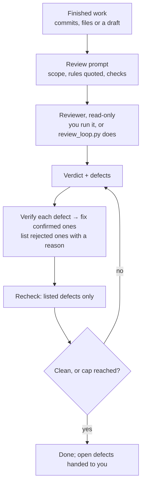

# review-loop

A different model (for example Codex when Claude did the work) reviews the finished work. The findings are verified and fixed, then a recheck covers only those findings. The reviewer never edits anything.

| | |
|---|---|
| **Input** | What to review, plus its plan and rule files. |
| **Output** | Prompt files and one review file (rechecks appended); in automatic mode, a run state file. |
| **Your files** | The reviewer changes nothing; only confirmed fixes are applied. |

- `review_loop.py run --subject S --prompt P --out REVIEW --cap N [--resume ID] [--model M] [--effort E] [--config K=V] [--log FILE]`. The optional flags are off by default. Missing output folders are created; the log is written last, so a log problem never loses a review.
- **Status:** experimental (2026-10-23). Used on documents and on other skills.
